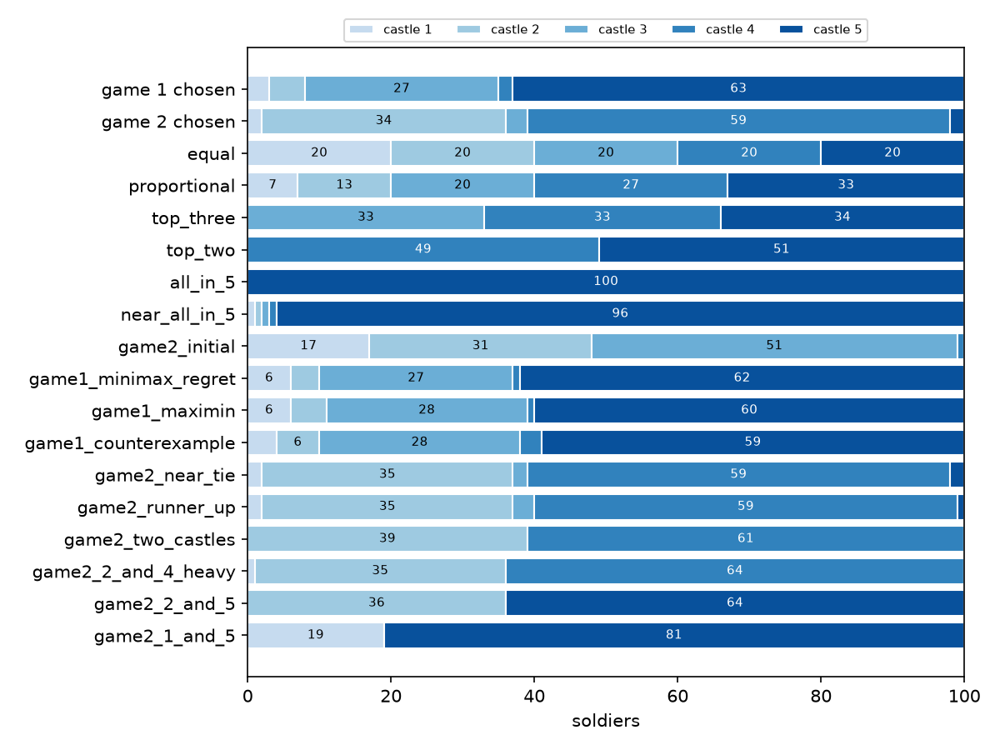
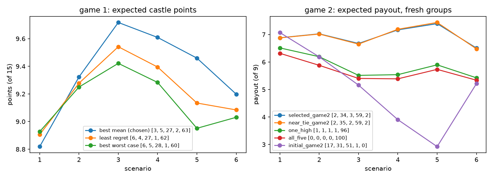
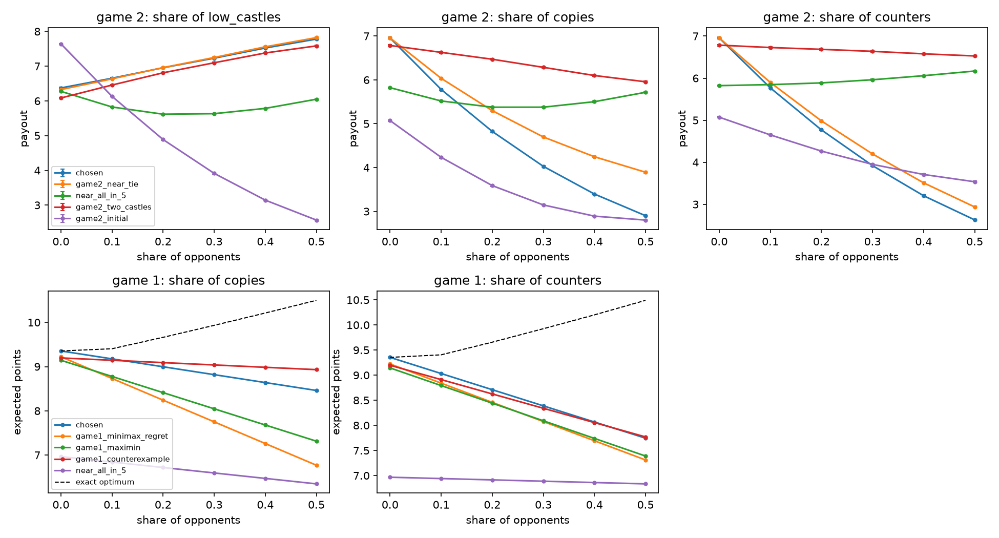
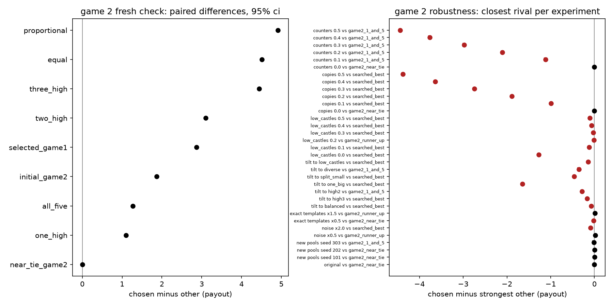

# Castle Allocation Study

How should 100 soldiers be split across five castles worth 1, 2, 3, 4 and 5 points? This repository explains and tests the two allocations I submitted for Sequoia's No Limit Castle Challenge.

Everything here is conditional on **synthetic** opponent models: hand-written templates plus random noise, defined in [`config.toml`](config.toml). No real applicant entries or other people's AI conversations were used. Nothing below proves an allocation is the best against the actual field.

## Rules

An allocation is five nonnegative integers that total 100. A higher bid wins a castle; tied top bids split it, including ties at zero.

- **Game 1 (one opponent):** score = castle points. The objective is **average castle points**, not how often we win.
- **Game 2 (four players):** players are ranked by castle points. Places pay `9, 4, 2, 0`, and tied players average the payouts of the places they share (all four tied: 3.75 each; two tied for first: 6.5 each). The objective is **average placement payout**.

## Chosen allocations

Castles are listed in order of value, 1 to 5.

| game | allocation | objective |
|---|---|---|
| 1 | `[3, 5, 27, 2, 63]` | average castle points |
| 2 | `[2, 34, 3, 59, 2]` | average placement payout |



## Results

All figures below are read from files in [`results/`](results); [`results/summary.md`](results/summary.md) has the full tables.

**Game 1.** Under the original six-scenario model, `[3, 5, 27, 2, 63]` averages **9.3542** of 15 castle points. Every one of the 4,598,126 legal allocations was scored exactly, and this one has the highest mean. A dynamic program finds the same answer independently. It is **not** the most cautious choice:

- `[6, 4, 27, 1, 62]` has the smallest worst-scenario regret.
- `[6, 5, 28, 1, 60]` has the best worst-scenario score.

**Game 2.** On 300,000 fresh groups drawn from the fixed opponent pools, `[2, 34, 3, 59, 2]` averages a payout of **6.9413**, with a 95% interval of [6.9298, 6.9528]. It finishes first alone in 66.5% of groups and ties for first in another 7.6%. It wins castles 2 and 4 outright in 77.3% of groups; its average payout in those groups is 8.39 and the lowest is 4.

**Near-tie.** `[2, 35, 2, 59, 2]` is indistinguishable from the chosen allocation. The chosen allocation minus it is −0.0004, with an interval of [−0.0021, +0.0012]. On a second set of fresh groups it is −0.0019 [−0.0045, +0.0007]. The evidence supports concentrating on castles 2 and 4. It does not settle where the last soldier goes.

**Benchmarks.** Each duel splits 15 points, so the whole field averages 7.5 in Game 1. Each group splits 15 payout points, so the field averages 3.75 in Game 2. These are field averages, not guarantees for any single allocation.



## Weaknesses

These come from new experiments, all run with both choices frozen ([`castle/robustness.py`](castle/robustness.py)). All experiments and baselines were fixed in `config.toml` before any robustness result was computed, with one exception: `[19, 0, 0, 0, 81]` was added afterward because the searches kept returning it.

- **Constructed losses.** `[4, 6, 28, 3, 59]` beats the Game 1 choice 10 to 5. In a Game 2 group of `[3,35,0,0,62]`, `[0,0,0,60,40]` and `[0,0,99,0,1]`, the chosen allocation wins no castle and gets 0.
- **Copies and counters.** If 10% of opponents copy the choice or bid just above it, Game 2 drops from 6.96 to about 5.8, and the best tested allocation is about 1 payout point better. Game 1 degrades more gently, from 9.35 to 9.18 (10% copies) or 9.03 (10% counters), while the exact optimum moves to about `[7, 16, 5, 6, 66]`.
- **The `low_castles` assumption matters.** The Game 2 choice depends on part of the field concentrating on castles 1–3. Without that family, `[17, 30, 52, 1, 0]`-style allocations are about 1.3 payout points better.
- **A field skewed toward one family changes the answer.** For example, giving `one_big` half the weight makes a castles 1–3 allocation better by 1.6. In Game 1, a field tilted toward `high3` or `equal` prefers castle-4-heavy allocations.
- **A very different rival.** `[19, 0, 0, 0, 81]` gives up castles 2–4 entirely. Under the original model it trails the Game 2 choice by only 0.034 [0.007, 0.060]. It is statistically tied with the choice under one regenerated pool (seed 303), and it beats the choice when the field tilts toward `high2` or `diverse` or contains counters. The model alone does not single out one strategy.
- **Noisier opponents.** At double the noise, or half as many exact template copies, a few nearby or searched allocations beat the Game 2 choice by small but resolved margins (0.02–0.09).
- **What is stable.** Game 1 is stable across regenerated pools and noise changes: the exact optimum moves by at most one or two soldiers, and the choice's regret stays at or below about 0.03. Game 2 with regenerated pools (seeds 101, 202, 303) keeps the choice first or statistically tied.




## Why the two games need different allocations

In Game 1, expected points split into five independent castle terms. Each extra soldier is worth `0.5 * v_i * (p_i(k) + p_i(k+1))`, so soldiers go where they convert the most opponents. That leads to heavy bids on castles 5 and 3, and small bids where opponents leave castles empty.

Game 2 pays for rank, and winning a castle means beating three bids at once. Winning castles 2 and 4 outright guarantees at least second place, because the other three players share only 9 points. Under this model that bet beats spreading soldiers out. See [MATH.md](MATH.md) for the derivations, the exact solver, and how each allocation follows from the model.

## Reproducing

```bash
pip install -r requirements.txt
```

```bash
python -m pytest -q
```

```bash
python -m castle quick
```

```bash
python -m castle all
```

`quick` takes a few seconds. `all` replays the original Game 1 and Game 2 runs, the fresh check and the robustness experiments, then writes figures and `results/summary.md`. It took about 4 minutes on an M-series Mac with NumPy only and no compiled code. Single steps are `game1`, `game2`, `fresh`, `robustness` and `report`.

The original run used Python 3.12.14 and NumPy 2.3.5 on x86-64 Linux ([`reference/environment.json`](reference/environment.json)). `requirements.txt` pins NumPy 2.3.5 and works on Python 3.12 and 3.13. [`results/manifest.json`](results/manifest.json) records what ran, how long it took, and where.

### What the replay reproduced

| original output | replay result |
|---|---|
| Game 1: seven opponent pools | identical |
| Game 1: all four objective winners and scores | identical allocations, values within 2e-15 |
| Game 2: all seven opponent pools, including the stateful `low_castles` draw | identical |
| Game 2: winners of both searches (`[17,31,51,1,0]`, then `[2,34,3,59,2]` at 6.9647216796875) | identical |
| Game 2: scores of every allocation both runs kept | identical (difference 0.0) |
| Game 2: shortlist membership | first search 262 of 263 shared; adaptive 722 of 724 shared |
| fresh check, all means and paired differences | identical |

The shortlist differences come from **exactly tied scores at shortlist cutoffs**. `np.argsort` is not stable, and NumPy's sorting code differs between x86 and ARM, so tied entries near the cutoff are kept in a different order. The allocations involved are far from the top. They do not change which pools are built or which allocation wins. The details are in `results/game2/summary.json → checks`.

The original C++ scorer is preserved in [`reference/originals/`](reference/originals) but not used. The NumPy scorer produces the same integer totals, and the tests check it against a plain Python reference scorer.

## Layout

```
config.toml          every model setting, copied from the original scripts, plus the new experiments
castle/scoring.py    rules: reference scorer, fast numpy scorer, payout table
castle/opponents.py  synthetic opponent pools and group sampling
castle/game1.py      expected-points model, exact dynamic program, exhaustive objectives
castle/game2.py      coarse-to-fine search, confidence intervals
castle/replay.py     replays of the original scripts, checked against reference/
castle/robustness.py new experiments with the choices frozen
castle/report.py     csv/json output, figures, results/summary.md
tests/               rules, conservation, symmetry, scorer agreement, dp vs brute force, exact pool replay
reference/           untouched original scripts, recorded outputs, checksums
results/             everything this code generated
```

## How I approached it

I treated each game as an optimization problem under an explicit opponent model and kept that model separate from the conclusions.

In Game 1, the expected score separates castle by castle, so I could find the exact best allocation for any model. I also checked how much the answer depends on the model.

Game 2 rewards placement, which couples the castles together. I searched it by simulation, from a coarse grid down to fine detail, then checked the choice on new groups and under many altered models.

Both choices hold up when the model's noise and random draws change. Both lose clearly when the field is unlike the model, most of all when other players think the same way I did. The exact last soldier in Game 2 is a coin flip under this evidence.

## Limitations

- The opponent families and scenario weights are assumptions. Every confidence interval covers only Monte Carlo sampling within a model, not whether the model is right.
- The Game 2 search is a Monte Carlo search, not an exhaustive one. The original stages named `validation` also chose the candidates, so they are selection-stage results, not untouched tests.
- No result here is a Nash equilibrium, a guarantee of winning, or a claim about the real applicant pool.

AI tools assisted with the analysis and the implementation.
